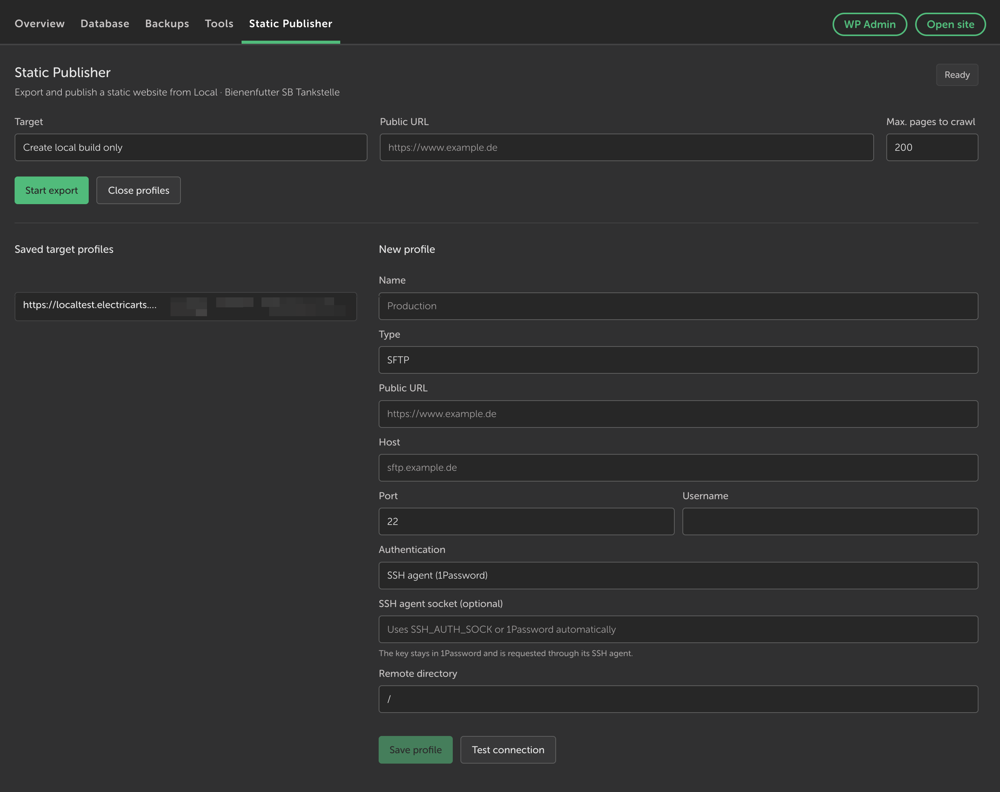

# Local Static Publisher – Local Add-on

An add-on for Local by Flywheel that renders a running local WordPress website as static files and optionally publishes it via SFTP or GitHub. The site only needs to provide fully renderable pages and assets in the browser.

## Interface



## Features

- Dedicated “Static Export” button in Local’s site view
- Works with WordPress sites regardless of the builder or theme used
- Dedicated “Static Publisher” page as an additional tab next to Overview, Database, Backups, and Tools
- Exports HTML pages, linked pages, stylesheets, scripts, images, and CSS assets
- Uses the WordPress sitemap as an additional URL source
- Rewrites the local origin URL to the public target URL
- Detects URLs embedded in inline JavaScript/CSS and dynamically loaded JavaScript chunks
- Creates a local build with `export-manifest.json`
- Saved SFTP target profiles
- SFTP authentication via password, private key, or SSH agent, including 1Password
- Automatically uses `~/.ssh/config` and default keys from `~/.ssh`
- GitHub commit transport through the Git Data API
- Progress indicator, warnings, and export output details

Forms, AJAX, authenticated content, client-side data loading, and complex URL/plugin-specific edge cases are intentionally not included yet.

## Installation

### Install a released build

1. Open the [latest GitHub release](https://github.com/electricarts/local-static-publisher/releases/latest).
2. Download the `local-static-publisher-<version>.tgz` asset.
3. In Local, open **Add-ons → Installed → Install from disk**.
4. Select the downloaded `.tgz` file and complete the installation.
5. Enable Local Static Publisher in the installed add-ons list if it is not enabled automatically.

The release archive already contains the compiled JavaScript and bundled runtime dependencies. It does not need to be extracted, and no npm installation or build step is required.

### Build from source

```bash
npm install
npm run build
```

Then register the add-on folder with Local. On macOS, the expected add-on path is:

```text
~/Library/Application Support/Local/addons/local-static-publisher
```

On Windows and Linux, use the add-on directories documented by Local. Restart Local and enable the add-on.

## Usage

1. Start a Local site.
2. Open the “Static Publisher” tab next to Overview, Database, Backups, and Tools.
3. Optionally create an SFTP or GitHub profile. Existing profiles can be edited with “Edit selected profile”. Use “Test connection” to verify the current SFTP or GitHub settings before saving.
4. Check the public URL and the page limit.
5. Choose “Start export” or “Export & publish”.

The local site is fetched through its frontend URL, so it must be running during the export.

For “Create local build only”, a folder picker opens before the export. Each export is automatically written to its own subfolder based on the site name and a timestamp, for example `my-local-site-2026-10-14T18-15-00-000Z`. Earlier builds are preserved.

HTML pages are written as flat files for every export type: `/contact/` becomes `contact.html`, and nested paths use `--` as a separator. Assets retain their directory structure. Internal links point to the exported files, while external links remain unchanged. SFTP and GitHub exports use a temporary local build and publish it afterward. If the configured page limit is reached, the publisher displays a warning and records the skipped pages in `export-manifest.json`.

For SFTP, select “SSH agent (1Password)” in the profile. The private key remains in 1Password; the exporter uses the available `SSH_AUTH_SOCK` or automatically detects the 1Password agent on macOS. No manual key upload is required.

Alternatively, select “SSH config / default key (~/.ssh)”. This option reads matching `Host`, `HostName`, `User`, `Port`, `IdentityFile`, and `IdentityAgent` entries from `~/.ssh/config`. Without a matching entry, it checks `id_ed25519`, `id_ecdsa`, `id_rsa`, and `id_dsa` in `~/.ssh`. The private key is read only during the export and is not stored in the target profile.

## Known limitations

- Password and private-key profiles are currently stored in a local file with restrictive file permissions. When using an SSH agent, no private key is stored in the target profile. A production version should use the operating system keychain.
- The SFTP transport synchronizes new and changed files but does not yet remove obsolete remote files.
- The GitHub transport requires the target branch to already exist.
- GitHub versions the static output, not the editable WordPress data structure.
- URL discovery is crawler-based and needs additional rules for multilingual sites, special routes, and large archives.

## Responsive Local layout

The publisher is rendered as its own page inside the site view. For narrow Local windows, it includes a responsive rule for the known mkcert panel: below 1180 px, mkcert may wrap below the Overview column. This rule is intentionally limited to the current mkcert layout and should be reviewed if the mkcert add-on changes.
